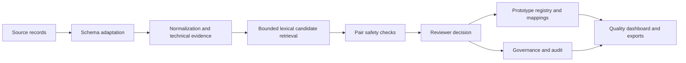

# Samanvay

Samanvay is a review-first prototype for harmonizing material descriptions across organization and source-system boundaries. It preserves each source record, derives only text-supported technical evidence, retrieves plausible candidates, explains conflicts, records qualified reviewer decisions, and exports a proposed registry with mappings back to original IDs.

The repository implements Phases 1–13 of the supplied SIH26099 master plan. The complete workflow is verified locally with SQLite and demo authentication. Managed Neon/PostgreSQL, OIDC and Vercel deployment validation remains pending external account setup.

## What is implemented



- Lossless CSV and conservative XLSX loading with source hashes, row provenance, raw fields and explicit missing-value issues.
- Conservative description normalization and evidence-backed extraction for family, size, grade, standard, pressure, voltage and model.
- Top-k exact, token, BM25-style lexical and fuzzy retrieval without a full all-pairs comparison.
- Pair outcomes: exact duplicate, near duplicate, possible functional equivalent, conflict and no match, with insufficient evidence kept reviewable.
- Critical conflict blocking for comparable size, pressure, voltage, grade and standard values.
- Explicit approve, reject, defer and reconsider operations with idempotency, workspace ownership and all-member safety checks.
- Stable opaque `SMV-P-*` prototype codes, readable and structured descriptions, source mappings and separate functional-equivalence relationships.
- Append-only decision, audit and mapping history.
- Browser search, comparison, decision, registry, governance, quality, export and integration-preview views.
- Local SQLite plus prepared PostgreSQL/OIDC/Vercel paths.
- Read-only CPSE/SAP-shaped mapping contracts and templates that feed the unchanged matching core.

`SMV-P-*` values are proposed workspace prototype identifiers. They are not official CPSE or national material codes.

## Verified local evidence

The final Phase 13 run:

- loaded all **9,245** provisional candidates with preserved source IDs;
- retrieved real pair `M000753` ↔ `M000925` and produced the existing `near_duplicate` rule proposal;
- blocked identity for deliberate cable conflict `M000830` ↔ `M000834`;
- created, reconsidered and restored a demonstration registry mapping;
- reconciled **2 mapped**, **9,243 unresolved**, **3 decision/audit events** and **1 active prototype registry entry** in the demonstration workspace;
- generated registry, mapping, audit and quality-workbook exports;
- mapped public and CPSE/SAP-shaped examples into the same matching inputs;
- preserved all three protected raw-file hashes;
- passed the complete **128-test** repository suite in the final validation run.

These are deterministic workflow and rule outputs, not measured matching accuracy. Human validation of the Phase 6 sample remains pending.

Evidence starts at [reports/phase13](reports/phase13), with the claim mapping in [docs/phase13_claim_evidence.md](docs/phase13_claim_evidence.md).

## Local setup

Use Python 3.13.

```powershell
py -3.13 -m venv .venv
.\.venv\Scripts\Activate.ps1
python -m pip install -r requirements.txt
python verify_raw_data.py

$env:SAMANVAY_STORAGE_BACKEND='sqlite'
$env:SAMANVAY_LOCAL_STORAGE_DIR='.local/samanvay-service'
$env:SAMANVAY_AUTH_MODE='demo'
$env:SAMANVAY_DEMO_TOKEN='choose-a-local-demo-token'
$env:SAMANVAY_DEMO_SUBJECT='local-demo-owner'

python seed_service.py --workspace public-demo --owner-subject local-demo-owner --public-read --local-dir .local/samanvay-service
python -m uvicorn api_service:app --host 127.0.0.1 --port 8000
```

Open `http://127.0.0.1:8000`. Public browsing works without a token. Enter the configured local token to perform owner-authorized review actions.

See [the final setup guide](docs/FINAL_SETUP.md), [local fallback guide](docs/LOCAL_FALLBACK.md), and [judge demo script](docs/FINAL_DEMO.md).

## Validation commands

```powershell
python -m unittest discover -s tests -v
python -m compileall -q .
node --check frontend/app.js
python verify_raw_data.py
python phase13_demo.py --output-dir reports/phase13-run
```

The evidence runner refuses to overwrite an existing directory.

## Data and provenance

The protected public snapshot contains 23,223 rows across the material-description corpus, NTPC extraction and IOCL procurement-plan extraction. The 9,245 working candidates are provisional rule-selected records. See [SOURCES.md](SOURCES.md), Phase 1 reports and [the common input contract](docs/common_input_format.md).

Raw files and original IDs remain intact. The public sources are procurement/tender surrogate text rather than a verified cross-CPSE material master. No inspected source supplies a confirmed legacy CPSE material code.

## Governance and integration boundaries

Public demo visitors have read-only access. The authenticated workspace owner may record review and reconsideration actions; the server derives identity from the token and checks ownership. Decisions and source records are transactionally protected, while audit and mapping history are append-only.

The Phase 12 boundary supports explicit file mappings and bounded validation previews. It performs no SAP/ERP writes, live synchronization or automatic ingestion. See [the integration contract](docs/phase12_integration.md).

## Limitations

- Human pair labels are pending, so no matching accuracy, precision, recall or false-merge performance is claimed.
- Attribute coverage and pair counts are rule outputs, not engineering validation.
- Possible functional equivalence remains a qualified-review suggestion.
- Transaction, stock, lifecycle, price and audited savings data are absent; savings, ROI and obsolescence claims are unsupported.
- There is no live SAP connection or ERP writeback.
- Managed PostgreSQL/OIDC/Vercel deployment has prepared code and documentation but has not been validated with external accounts. No public URL is claimed.
- A clean filesystem copy passed before commit. The committed-tree clone check is recorded in the Phase 13 checkpoint. Remote publication is pending repository permission for the currently authenticated GitHub account.

## Submission material

- [Phase 13 checklist](PHASE13.md)
- [Claim and evidence matrix](docs/phase13_claim_evidence.md)
- [Architecture and workflows](docs/phase13_architecture.md)
- [Presentation outline](docs/PRESENTATION_OUTLINE.md)
- [Phase 13 evidence pack](reports/phase13)
- [Deployment instructions and pending setup](docs/phase8_deployment.md)

Fresh checkouts rebuild missing ignored Phase 3 output from committed candidates through the existing adapter and derivation pipeline.
