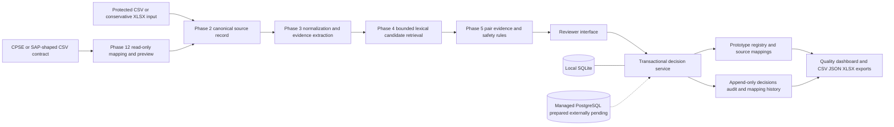
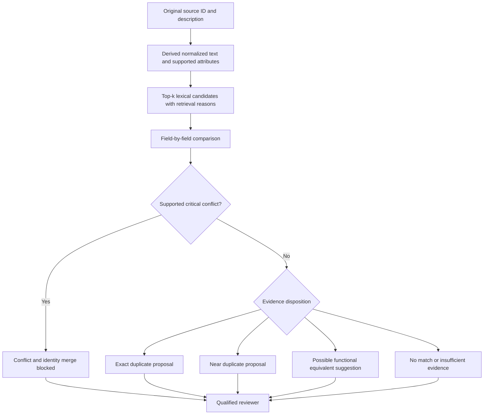
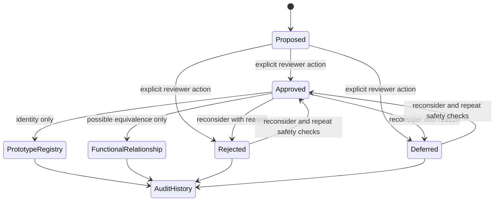
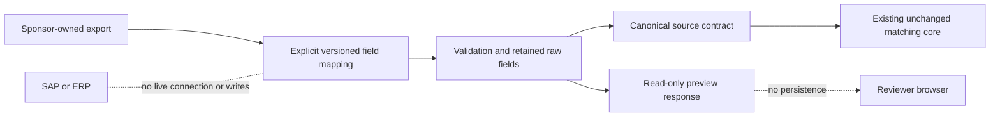

# Samanvay final architecture and workflows

These diagrams show implemented components only. Dashed external deployment paths are prepared but not validated with managed accounts.

## End-to-end architecture

## Material matching workflow

## Reviewer and governance lifecycle

## Integration boundary

Final acceptance note: committed-checkout seeding uses a tested fallback from committed candidate data when the ignored Phase 3 pack is absent.
